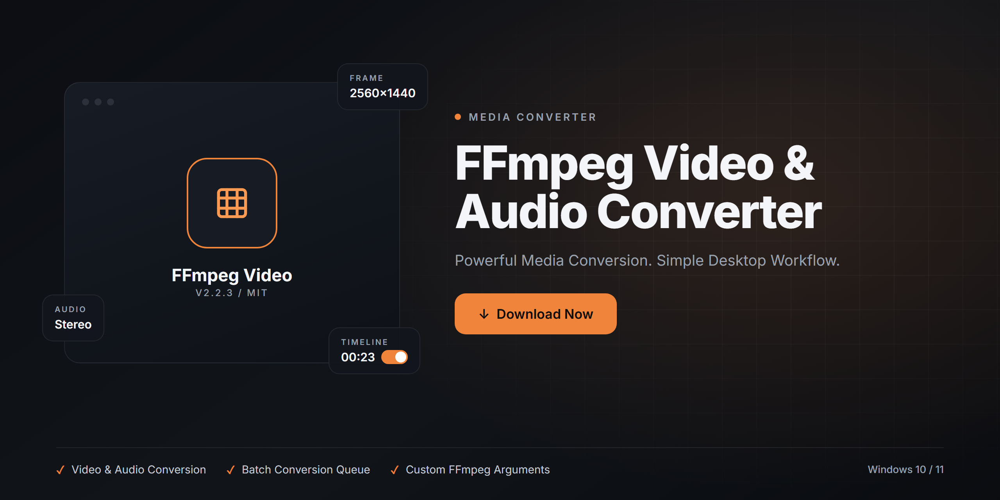
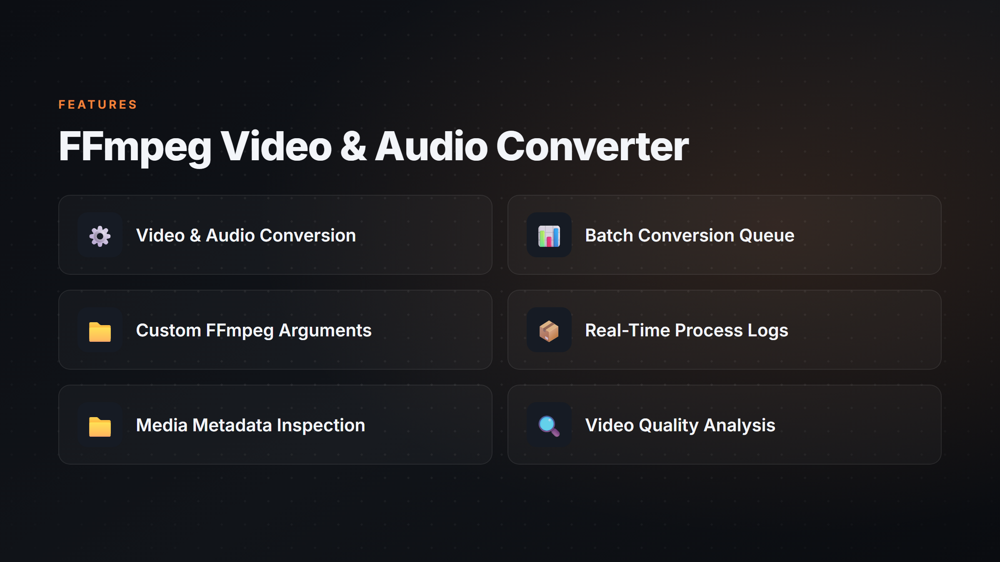

**Convert, process, and analyze multimedia files with the power of FFmpeg through an intuitive Windows desktop application.**

**FFmpeg Video & Audio Converter** is a free, open-source desktop GUI for Windows that makes professional video conversion, audio encoding, and media processing accessible to everyone. Manage multiple conversion jobs, inspect media information, customize FFmpeg parameters, and analyze video quality without needing to use the command line.

## ⬇️ Installation

**Download the Windows application**

1. Open the repository's [Releases](https://github.com/umbradev315/ffmpeg-video-audio-converter/releases) page.
2. Download the latest release archive **`FFmpeg Video & Audio Converter 4.3.4.zip`**.
3. Extract the archive into a folder of your choice.
4. Keep **`FFmpeg Video & Audio Converter 4.3.4.exe`** and `libvlc.dll` together in that folder.
5. Double-click **`FFmpeg Video & Audio Converter 4.3.4.exe`** to launch the application.

## ✨ Features

- 🎬 **Video Conversion** — Convert video files between popular multimedia formats using the powerful FFmpeg processing engine.
- 🎵 **Audio Conversion** — Encode and convert audio files with flexible format and encoding options.
- 📦 **Batch Conversion Queue** — Add multiple media files and process conversion jobs through an organized queue.
- ⚙️ **Custom FFmpeg Arguments** — Fine-tune encoding settings and advanced media processing with your own FFmpeg parameters.
- 📊 **Real-Time Process Logs** — Follow conversion progress and inspect FFmpeg output directly inside the desktop interface.
- 🔍 **Media Information Inspector** — Explore technical media properties, codecs, streams, resolutions, and other file metadata.
- 🧪 **Video Quality Analysis** — Run VMAF, PSNR, and SSIM comparisons to evaluate video encoding quality and compression results.

## 🖼️ Overview

The application combines everyday media conversion tools with advanced FFmpeg functionality in one convenient desktop workspace.

### 🎯 Built for Different Workflows

| Workflow | What you can do |
|---|---|
| Video conversion | Change video formats and encoding settings |
| Audio conversion | Process audio files using FFmpeg |
| Batch processing | Organize multiple conversion tasks |
| Advanced encoding | Supply custom FFmpeg arguments |
| Media inspection | Review technical file information |
| Quality evaluation | Compare video quality using objective metrics |

### 🛠️ Powered by FFmpeg

FFmpeg provides the underlying multimedia processing capabilities, supporting a wide range of formats, codecs, containers, and encoding workflows.

The graphical interface makes these capabilities easier to access while retaining the flexibility expected by experienced media enthusiasts.

**Video quality analysis note:** VMAF functionality requires an FFmpeg build compiled with VMAF support. PSNR and SSIM availability depends on the installed FFmpeg build and supported filters.

## 🚀 Usage

Getting started with the graphical FFmpeg converter is straightforward:

1. **Launch the application** — Open the Windows desktop application.
2. **Configure FFmpeg** — Select an available FFmpeg executable when prompted.
3. **Choose your media** — Add the video or audio files you want to process.
4. **Configure conversion** — Select your preferred conversion settings or provide custom FFmpeg arguments.
5. **Process your files** — Add jobs to the queue and start processing.
6. **Inspect the results** — Review process logs and explore the resulting media information.
7. **Analyze quality** — Run available VMAF, PSNR, or SSIM evaluations when supported by your FFmpeg installation.

### 💡 Supported Processing Capabilities

The available conversion and encoding options depend on your FFmpeg build.

Common workflows include:

- Video transcoding and re-encoding.
- Audio extraction and conversion.
- Codec and container changes.
- Video resolution and bitrate adjustments.
- Custom encoding parameters.
- Multimedia metadata inspection.
- Objective video quality comparison.

## 🔒 Security & Privacy

Your media processing workflow should remain transparent and under your control.

- **No telemetry** — No built-in behavioral tracking or analytics collection.
- **No account required** — Use the desktop application without creating an online account.
- **Local processing** — Media conversion is handled through your configured local FFmpeg installation.
- **Open-source transparency** — The source code can be inspected and audited.
- **Explicit configuration** — You choose which FFmpeg executable the application uses.
- **Issue reporting** — Report bugs, unexpected behavior, or security concerns through the GitHub Issues section.

Always obtain FFmpeg binaries from trusted sources and verify third-party builds before using them.

## 🖥️ System Requirements

| Component | Requirement |
|---|---|
| Operating system | Windows |
| Processing engine | FFmpeg and FFprobe |
| Recommended FFmpeg | Version 7.1 or newer |
| Storage | Sufficient space for source files and converted media |
| Internet connection | Not required for local media conversion |

**FFmpeg compatibility:** The application requires accessible FFmpeg and FFprobe executables. Compatible binaries may be supplied with application releases.

For advanced video quality analysis, ensure your FFmpeg build includes the necessary VMAF, PSNR, and SSIM functionality.

## ⚡ Why Use a Graphical FFmpeg Converter?

FFmpeg is an exceptionally flexible multimedia framework, but its command-line interface can be intimidating for users who simply want to convert their media files.

This Windows FFmpeg GUI brings essential functionality into a graphical workflow without removing access to advanced processing options.

- Spend less time remembering FFmpeg commands.
- Organize multiple conversions in one place.
- Inspect processing output without switching applications.
- Access technical media information more conveniently.
- Retain control through custom encoding arguments.
- Evaluate video compression and quality with objective metrics.

Whether you're converting personal videos, preparing audio assets, experimenting with codecs, or comparing encoding configurations, the application provides a practical interface for your multimedia workflow.

## 🤝 Contributing

Contributions from the open-source community are welcome!

You can help improve the project by:

- Reporting reproducible bugs.
- Suggesting new conversion features.
- Improving application usability.
- Testing different FFmpeg configurations.
- Reviewing code and submitting improvements.
- Improving documentation and examples.

When reporting an issue, include your Windows version, FFmpeg version, relevant application logs, and steps to reproduce the problem.

## 📄 License

This project is distributed under the **MIT License**.

You are free to use, modify, and distribute the software in accordance with the license terms.